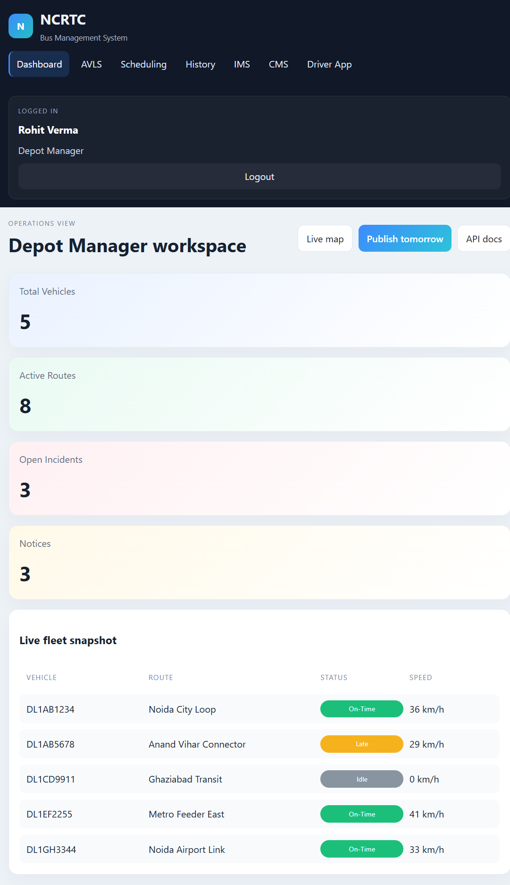
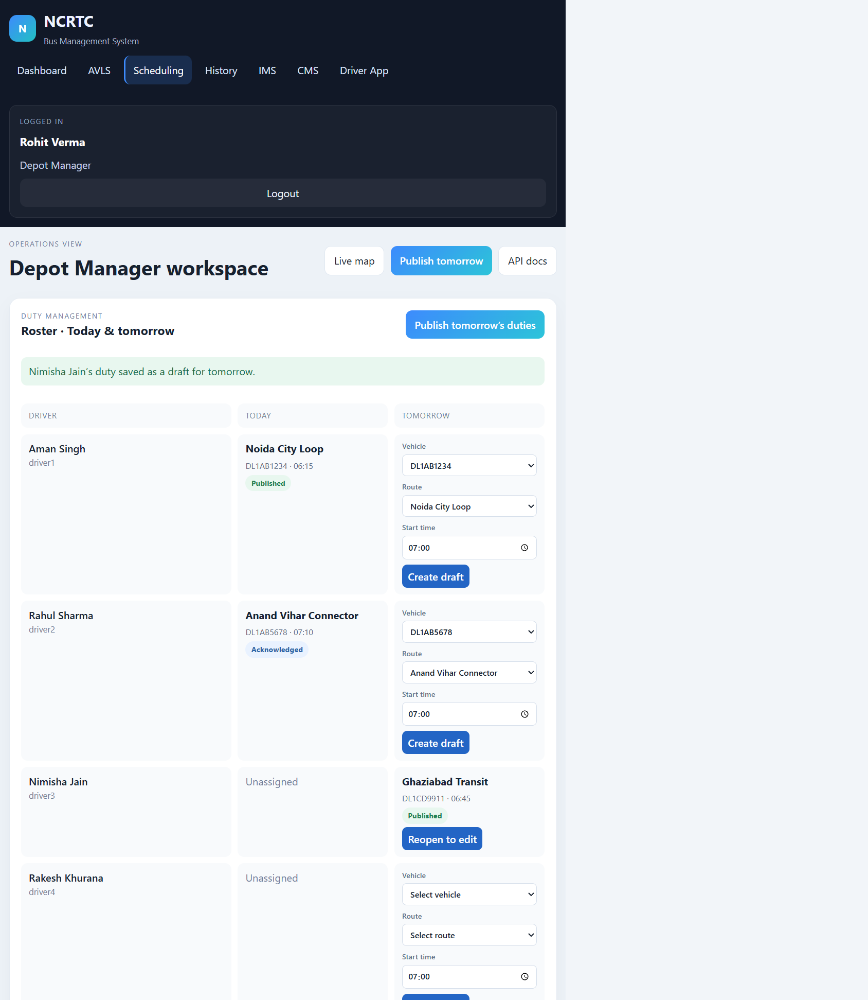
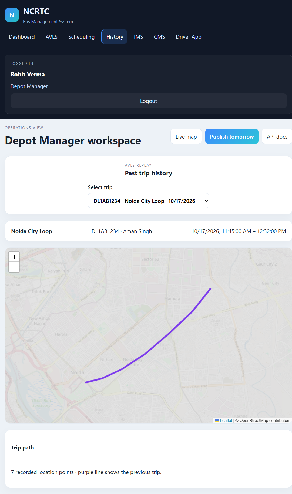

# NCRTC Bus Management System

This project is a student capstone implementation inspired by the NCRTC BMS PRD Lite specification.

## Quickstart

**Requirements:** Docker Desktop with Docker Compose.

From the repository root, start the full app:

```bash
docker compose up --build
```

When the backend health check passes, open **http://localhost:5174** and sign in with **admin1 / password**. For later runs, `docker compose up` is enough. The API and Swagger UI are available at **http://localhost:8100** and **http://localhost:8100/docs**.

Stop the running stack with `Ctrl+C`. To remove the demo database and reseed from scratch, run `docker compose down -v` before starting it again. This deletes the persisted demo data.

## Stack

- Frontend: React + Vite + Leaflet
- Backend: Express.js
- Data: SQLite database with idempotent demo seeding
- Containerization: Docker Compose
- Architecture note: [docs/architecture.md](docs/architecture.md)
- Assumptions and architectural decisions: [docs/assumptions-and-decisions.md](docs/assumptions-and-decisions.md)

## Database seed

The backend seeds the SQLite database automatically during startup: `initDatabase()` creates the tables, then calls `seedUsers()` and `seedData()` in [backend/server.js](backend/server.js#L259). The seed functions are defined in [backend/server.js](backend/server.js#L94) and [backend/server.js](backend/server.js#L116); no separate seed command is required.

On an empty database, the seed creates the demo accounts, depots, routes, vehicles, duties, incidents, notices, and an October 17 historical trip for the History map replay. Seeding is designed to be safe on subsequent starts: seeded users/routes use `INSERT OR IGNORE`, and other sample groups are inserted only when their tables are empty. A small startup migration also repairs legacy demo driver assignments without overwriting valid driver assignments.

For local development, SQLite is stored at `backend/data/ncrtc.db`. Docker Compose stores it in the `ncrtc_data` named volume. To rerun the full seed from a clean database, stop Compose and run `docker compose down -v`, then `docker compose up`; this removes all data in that Compose volume.

## Features implemented in this MVP

- AVLS live map with depot filter and vehicle cards
- Scheduling roster grid for drivers and vehicles
- JWT authentication with bcrypt-hashed demo passwords
- AVLS fleet map with depot filtering and vehicle details
- Scheduling roster and route create, edit, and delete workflows
- Manager duty publishing and driver acknowledgement workflows
- IMS incident details with a persisted status/event timeline
- Driver P1 panic alerts and control-room assignment queue
- CMS notices with persisted driver read receipts
- Simulated live AVL position refresh and replayable historical trip path
- Swagger API explorer at `/docs`
- Demo accounts for admin, manager, control room, five drivers, and executive roles
- SQLite persistence under `backend/data/ncrtc.db`

## Screenshots

Captured from the running demo app:

### Operations dashboard



### Manager duty roster



### Historical trip replay



## Run locally

### Option 1: backend + frontend (local)

```bash
cd backend
npm install
npm run dev
```

Then, in a second terminal, from `frontend`:

```bash
npm install
npm run dev -- --host 0.0.0.0
```

### Option 2: Docker Compose

```bash
docker compose up
```

Compose builds both images on first use. Wait for the backend health check, then open `http://localhost:5174`.

### Demo rehearsal

1. Sign in as `admin1` / `password`; view the dashboard, open **Scheduling**, and create a route.
2. Sign out, sign in as `manager1` / `password`; open **Scheduling**. Edit a draft in the **Tomorrow** column or create one for an unassigned driver by choosing a vehicle, route, and start time, then save it. Click **Publish** for that duty or **Publish tomorrow's duties** for all saved drafts. Reopen a published duty to revise it.
3. Sign out, sign in as `driver1` / `password` in a phone-sized window. The driver portal opens automatically; acknowledge today's duty, open the latest notice, and press **Panic Button · Send P1 alert**.
4. Sign out, sign in as `ops1` / `password`; open **Live map**. Vehicle positions and the incident queue refresh every four seconds. Select a map marker and assign the new P1 incident from the queue.
5. Open **History** and select the seeded October 17 trip to replay its path.
6. Open **API docs** in the header or visit `http://localhost:8100/docs`.

The seeded dashboard and demo accounts are initialized automatically when the database is empty. The new route, duty acknowledgement/publication, notice receipt, and incident workflow are persisted in the SQLite volume.

To reset the demo database and re-run the seed from scratch, stop the stack and remove its named volume with `docker compose down -v`, then run `docker compose up` again.

## Demo credentials

All demo accounts use the password `password`:

| Role | Username |
| --- | --- |
| Admin | `admin1` |
| Depot Manager | `manager1` |
| Control Room | `ops1` |
| Driver | `driver1` |
| Additional drivers | `driver2`, `driver3`, `driver4`, `driver5` |
| Executive | `exec1` |

## Notes

This remains a capstone/demo system. Before deployment, configure a strong `JWT_SECRET`, use HTTPS, and review authorization rules and operational data requirements.
# ncrtcproject
