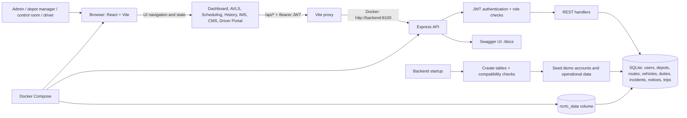

# NCRTC Bus Management System — Architecture Note

**Document status:** Current demo architecture and recommended next steps  
**Audience:** Capstone reviewers, developers, and demo operators  
**Scope:** The React/Vite user interface, Express API, SQLite persistence, role workflows, and local Docker Compose deployment.

## 1. System overview

The NCRTC Bus Management System (BMS) is a browser-based operations demo. It brings together fleet visibility, route and duty planning, driver communications, incident handling, and trip replay in one application. The current implementation is deliberately small enough to run locally with Docker Compose and seeded data. It demonstrates workflows; it is not connected to live NCRTC vehicles, dispatch systems, or identity services.

At runtime, the browser downloads a React application from Vite. The frontend sends same-origin `/api` calls to Vite's development proxy; in Compose, that proxy resolves the backend service name. Express validates the JWT for protected routes, applies role checks to selected write operations, and reads or writes SQLite. The SQLite database lives on a named Docker volume in Compose so ordinary container restarts retain demo changes. Startup creates missing tables and seeds demo records.

### Main components

| Component | Current implementation | Responsibility |
| --- | --- | --- |
| Web client | React 18, Vite, React Leaflet, Leaflet | Role workspaces, forms, maps, and user actions |
| API | Node.js, Express 4 | Authentication, authorization, REST operations, Swagger UI |
| Persistence | SQLite through `sqlite3` | Local users, routes, fleet, roster, incident and notice workflow, trip history |
| Password/JWT | `bcryptjs`, `jsonwebtoken` | Password hashing and signed, expiring bearer tokens |
| Local orchestration | Docker Compose | Backend/frontend startup order, port mapping, health check, persistent data volume |

## 2. Runtime and request flow

1. Compose starts the backend, mounts `ncrtc_data` at `/app/data`, and sets `PORT`, `DATABASE_PATH`, and `JWT_SECRET`.
2. The backend creates its SQLite directory, opens the database, creates any missing tables, applies small compatibility checks, and seeds demo data. The health endpoint is used by Compose to determine when the API is ready.
3. The frontend starts after the backend health check succeeds. The browser opens `http://localhost:5174`; the API is available at `http://localhost:8100` and the Swagger UI at `/docs`.
4. Login posts a username and password to `/api/login`. Passwords are compared to bcrypt hashes. On success, the backend issues an eight-hour JWT containing the user ID, username, role, name, and depot ID.
5. The client stores that token in browser `localStorage` and sends it as `Authorization: Bearer ...` on protected requests. On reload it calls `/api/auth/me` to validate the session, then loads the dashboard and operational data.
6. Mutations write to SQLite and the client reloads the affected collections. Examples include creating a route, editing or publishing a duty, recording a notice read receipt, creating a panic incident, and assigning an incident.

The UI centralizes its API helper and data loading in `frontend/src/App.jsx`. The Express routes, schema setup, migration helpers, and seed logic currently live together in `backend/server.js`; the OpenAPI schema is defined in `backend/openapi.js`. This is easy to start and demo, but the server file is intentionally not yet divided into production service/repository layers.

## 3. Functional modules and how they are built

### Dashboard

The dashboard requests aggregate totals from `/api/dashboard` and combines those with the fleet list. It presents vehicle, route, open-incident, and notice counts plus a fleet snapshot. Counts are computed from SQLite on the server; dashboard and fleet data are loaded after authentication. The browser view is a summary of the seeded/demo database, not a real-time control-room KPI service.

### AVLS — fleet map

The AVLS view renders fleet vehicles as Leaflet markers on OpenStreetMap tiles. Operators can filter by depot and click a marker to view registration, driver, route, status, and recent sample pings. While the AVLS tab is active, the client polls the vehicle and incident endpoints every four seconds and refreshes the displayed values.

**Important boundary:** live movement is simulated. `/api/vehicles` derives small coordinate and speed variations from the stored seed values; no GPS device, vehicle modem, AVL provider, geofence engine, or durable telemetry stream is connected. The visual update proves the interaction loop only.

### Scheduling — routes and duties

Admin users can create, update, and delete routes. The route form captures a name, depot, and comma-separated stops; the API stores the stops as JSON in SQLite. Admins and depot managers can create a tomorrow draft duty for a driver, vehicle, route, and start time; edit a draft; reopen a published duty as a draft; and publish it. Drivers can see their own duties and acknowledge a published duty. The roster displays today's and tomorrow's assignments.

The demo uses the strings `today` and `tomorrow` instead of calendar dates. The server checks that the selected driver, vehicle, route, and time exist in an acceptable form, and prevents duplicate tomorrow duties for the same driver. It does not yet implement a complete optimization engine, resource-conflict validation, recurring rosters, depot-specific scoping, or a calendar/time-zone model.

### Driver Portal

Drivers land in the mobile-oriented driver portal after login. It shows the current user's duty, provides an acknowledgement action, opens the latest notice and records a read receipt, and exposes a panic button. The panic action creates a P1 incident associated with the driver's assigned vehicle and depot. The UI is responsive at phone-sized viewports, but it remains a web page rather than a native mobile application and does not use device GPS or push notifications.

### IMS — Incident Management System

Authenticated users can create P1/P2/P3 incidents; the driver panic workflow creates P1 incidents. Incident status changes and assignments are restricted to admin, depot manager, and control-room roles. The API stores incident records and appends workflow events to `incident_events`. The control-room view polls the incident queue with fleet updates, shows active geolocated incidents as map markers, and allows an operator to assign an incident. A marker click selects and highlights the corresponding queue row.

Incident coordinates are copied from the associated vehicle's stored position or accepted from the request. In this demo they are not a verified emergency caller position, and the event log is not an immutable audit ledger.

### CMS — notices

Admin, depot manager, and control-room users can publish notices. Drivers can open notices and create a durable per-user read receipt in `notice_reads`; the API returns read counts and reader usernames. Audience labels are stored for display, but full audience filtering, delivery guarantees, push delivery, and per-depot access policies remain future work.

### History — trip replay

`trips` stores vehicle, route, driver, timestamps, and a JSON coordinate path. The seeded October 17 trip is returned by `/api/trips`; selecting it loads `/api/trips/:id` and draws the path as a polyline on a Leaflet map. This is a fixed sample path, not a replay generated from retained AVL pings. Trip ingestion, map-matched traces, retention policy, filtering, and playback controls are not implemented yet.

### Authentication and authorization

The API has a login route, `/api/auth/me`, JWT middleware, and a `requireRoles` guard. Protected API reads require a bearer token. Writes have role guards where the workflow calls for them: route/duty management is limited to admin and depot manager, incident assignment/status changes to admin, depot manager, and control room, and duty acknowledgement to drivers. Incident creation is available to any authenticated role so driver emergencies can be raised. This is a demo role model—not a full authorization policy: depot scoping and per-resource ownership checks are incomplete.

### API documentation

Swagger UI is served by `swagger-ui-express` at `/docs`, using the OpenAPI definition in `backend/openapi.js`. It documents the principal authentication, fleet, route, duty, incident, notice, and history endpoints. Keep the API implementation and this OpenAPI contract synchronized when routes change.

## 4. Data model and persistence

The application uses a single SQLite database. Tables include:

- `users` — login name, bcrypt hash, display name, role, depot.
- `depots` — depot name, region, and map coordinates.
- `routes` — route name, depot, and JSON-encoded stop list.
- `vehicles` — registration, depot, route, driver, status, coordinates, and speed.
- `duties` — driver, vehicle, route, day label, status, and start time.
- `incidents` and `incident_events` — current incident state and append-style workflow events.
- `notices` and `notice_reads` — published notices and unique per-user read receipts.
- `trips` — historical trip metadata and JSON coordinate path.

Startup runs `CREATE TABLE IF NOT EXISTS`, adds incident coordinate columns when missing, and invokes idempotent seed helpers. Demo users and sample routes use `INSERT OR IGNORE`; several other fixture groups seed only when their table is empty. A compatibility update repairs known legacy demo driver-ID mismatches while preserving assignments that already reference a valid driver. The seed path is convenient for a capstone, but it is not a versioned database migration system. SQLite foreign-key enforcement and a comprehensive relational constraint set have not been configured.

For local Node development the default database is `backend/data/ncrtc.db`. Compose sets `DATABASE_PATH=/app/data/ncrtc.db` and persists `/app/data` in the `ncrtc_data` named volume. Removing that volume with `docker compose down -v` deletes all Compose demo data and causes fixtures to be seeded on the next startup.

## 5. Deployment topology

Compose defines two services:

- **backend** builds from `backend/Dockerfile`, listens on container/host port `8100`, owns SQLite initialization, and has an `/api/health` check.
- **frontend** builds from `frontend/Dockerfile`, serves Vite on port `5174`, and waits for the backend to become healthy. Its `/api` and `/docs` proxy targets `http://backend:8100` inside the Compose network.

The frontend port is exposed at `http://localhost:5174`; the API port is exposed at `http://localhost:8100`. Dockerfiles use lockfile-based `npm ci` and Debian slim Node images (rather than Alpine) for a more predictable native `sqlite3` install. This is a development/demo Compose topology: Vite is the frontend server, there is no production static asset server or reverse proxy, and there is no separate database service.

## 6. What should improve next

Priorities below distinguish changes needed before real operations from useful maintainability work.

### Priority 0 — security and operational safeguards

1. **Secrets and accounts:** remove the fallback JWT secret, require a deployment-provided random secret, rotate demo passwords, and disable demo accounts outside local/test environments. Store secrets in a managed secret store in production.
2. **Authorization:** enforce depot scoping on queries and writes, constrain driver access to their own duties/notices, and define a role/permission matrix. Verify every mutating endpoint follows it.
3. **Input and abuse controls:** add request schemas, length/range validation, rate limits for login and panic actions, secure headers, explicit CORS origins, HTTPS termination, and safe structured error responses. Panic actions need a visible confirmation/duplicate-alert policy appropriate for the demo.
4. **Auditing and backup:** persist actor, timestamp, and before/after state for operational changes; define SQLite backup/restore and retention procedures before relying on stored data.

### Priority 1 — production data and transport

1. **Database evolution:** move operational deployment to PostgreSQL (and PostGIS if spatial queries are required); introduce versioned migrations, foreign keys, indexes, transactions for multi-table incident changes, and integration tests for upgrades.
2. **Real AVLS:** ingest authenticated GPS telemetry from an approved provider/device, validate timestamps and coordinates, store timestamped location events, and deliver updates via WebSocket or server-sent events instead of synthetic positions and four-second polling.
3. **Duty scheduling:** replace `today`/`tomorrow` labels with service dates and depot time zones; add vehicle/driver overlap checks, availability, leave, publish versioning, notifications, and clear conflict resolution.
4. **Trip history:** create trips from persisted telemetry, add retention and access rules, and provide replay speed, time range, stop/geofence events, and trace-quality indicators.

### Priority 2 — maintainability and verification

1. Split `backend/server.js` into route/controller, service, data-access, schema/migration, and configuration modules. Keep business rules independent of Express and SQLite.
2. Split `frontend/src/App.jsx` into feature components and hooks (dashboard, fleet, roster, incidents, driver, history); adopt TypeScript or runtime schemas for API contracts and loading/error states.
3. Add automated unit and API integration tests, plus browser end-to-end tests for admin route creation, manager duty publishing, driver panic, control-room assignment, and trip replay. Run these with a clean temporary database in CI.
4. Add structured logs, request IDs, health/readiness distinction, metrics, alerting, dependency vulnerability review, and a production build/deploy pipeline.

## 7. Readiness statement

The current architecture is suitable for a local capstone demonstration and for explaining the intended operational workflows. The simulated location updates, seed credentials, demo JWT secret fallback, limited depot authorization, development Vite server, and simplified SQLite schema mean it is **not production-ready** and must not be used to dispatch real vehicles or respond to real emergencies without the improvements above.
